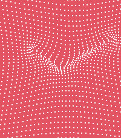
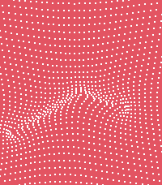

# gravity




A Pebble watchapp/watchface written in C using the Pebble SDK.

## Building & running

```sh
pebble build                          # build for all targetPlatforms
pebble install --emulator emery       # install on the emery emulator
pebble install --phone <ip>           # install to a paired phone
```

## Store screenshots

```sh
scripts/screenshots.sh                # every platform, into store-screenshots/
scripts/screenshots.sh basalt chalk   # only some platforms
```

The scenes (file name, time and settings) are listed at the top of
`scripts/screenshots.sh`. Each one is built with the time frozen
(`SCREENSHOT_TIME=HH:MM pebble build`), and its settings are sent to the
emulator the same way the phone sends them.

## Target platforms

`targetPlatforms` in `package.json` controls which watches you build for. The
modern Pebble hardware is **emery** (Pebble Time 2), **gabbro** (Pebble Round
2), and **flint** (Pebble 2 Duo); the original Pebble platforms (aplite,
basalt, chalk, diorite) are included by default for backwards compatibility.

## Project layout

```
src/c/           C source for the watchapp
src/pkjs/        PebbleKit JS (phone-side) source, if any
worker_src/c/    Background worker source, if any
resources/       Images, fonts, and other bundled resources
package.json     Project metadata (UUID, platforms, resources, message keys)
wscript          Build rules — usually no need to edit
```

By default this project is configured as a watchapp. To make it a watchface,
set `pebble.watchapp.watchface` to `true` in `package.json`.

## Documentation

Full SDK docs, tutorials, and API reference: <https://developer.repebble.com>
